<!--
  Você abriu o código-fonte. Pouca gente faz isso.
  You opened the source. Few people do.

  nível 2/3: synt{pbzragnevb_gnzorz_r_pbqvtb}
  dica: César giraria 13 casas. / hint: Caesar would rotate 13.

  O nível 3 não está em nenhum arquivo: foi apagado. Mas o git nunca esquece.
  Level 3 is not in any file: it was deleted. But git never forgets.
-->

  <a href="https://nexus-cliente-hub.vercel.app/"></a>

  
  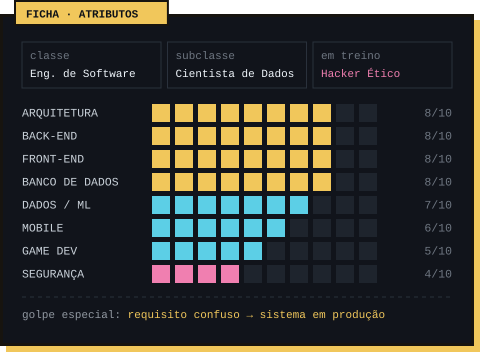

  <a href="https://pedroa07.github.io/Sonara-download/">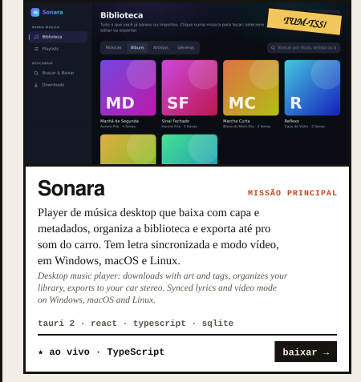</a><a href="https://pedroa07.github.io/Interface-Manda-Chuva-Bot/">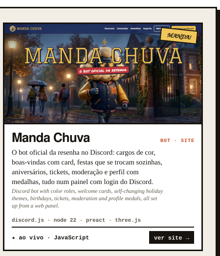</a>
  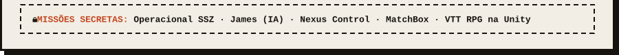

  <a href="https://pedro-widgets.vercel.app/api/spotify/open"><picture>
    <source media="(prefers-color-scheme: dark)" srcset="https://pedro-widgets.vercel.app/api/spotify?theme=dark">
    <source media="(prefers-color-scheme: light)" srcset="https://pedro-widgets.vercel.app/api/spotify?theme=paper">
    
  </picture></a>
  

  <a href="https://github.com/PedroA07/PedroA07/issues/new?title=flag%3A%20">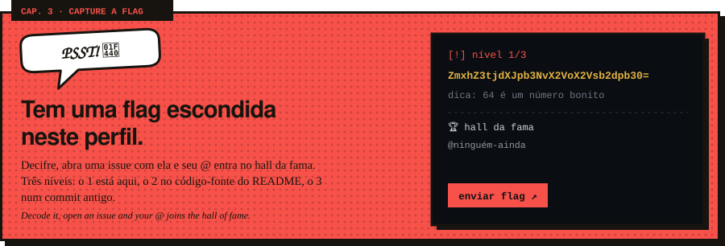</a>

  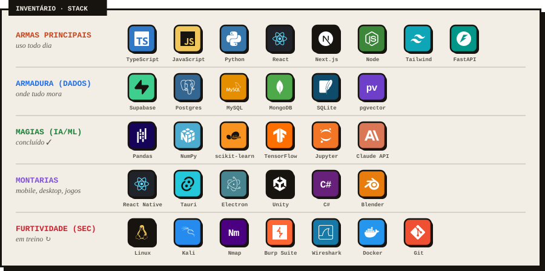

  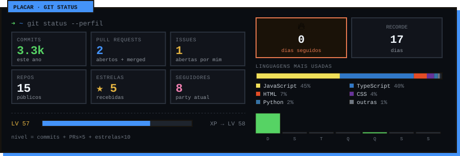

  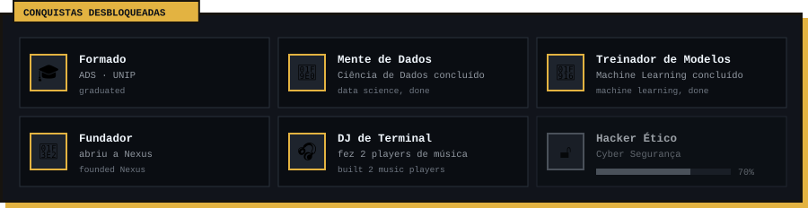

  

  
  
  <a href="https://steamcommunity.com/id/GamesPedr0/">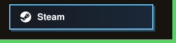</a>

  

